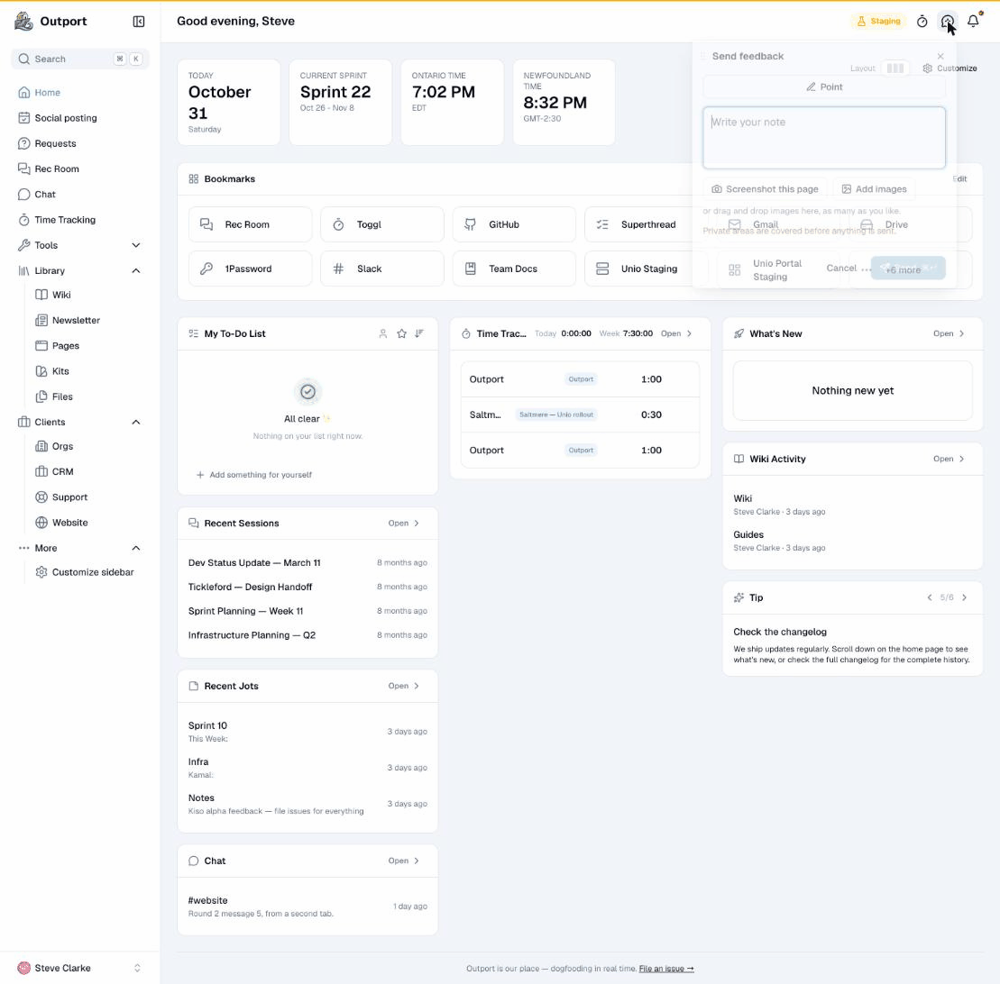
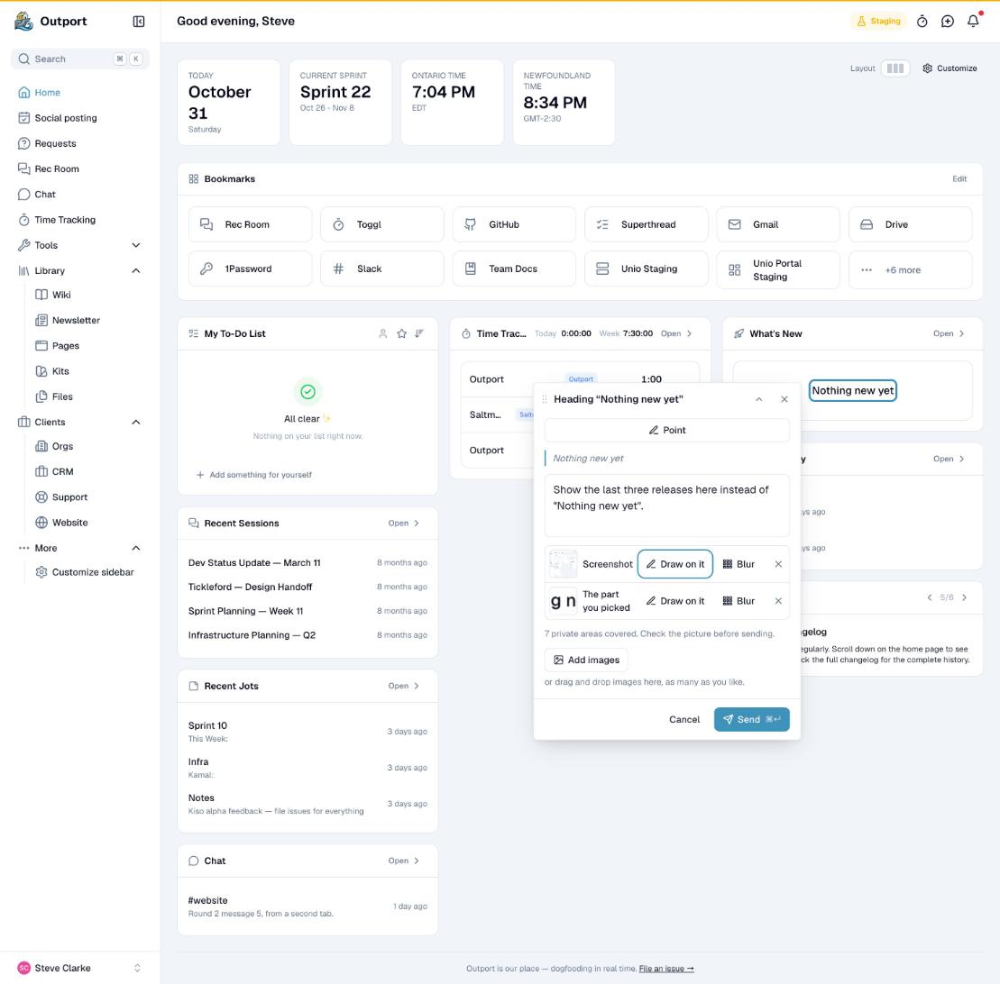
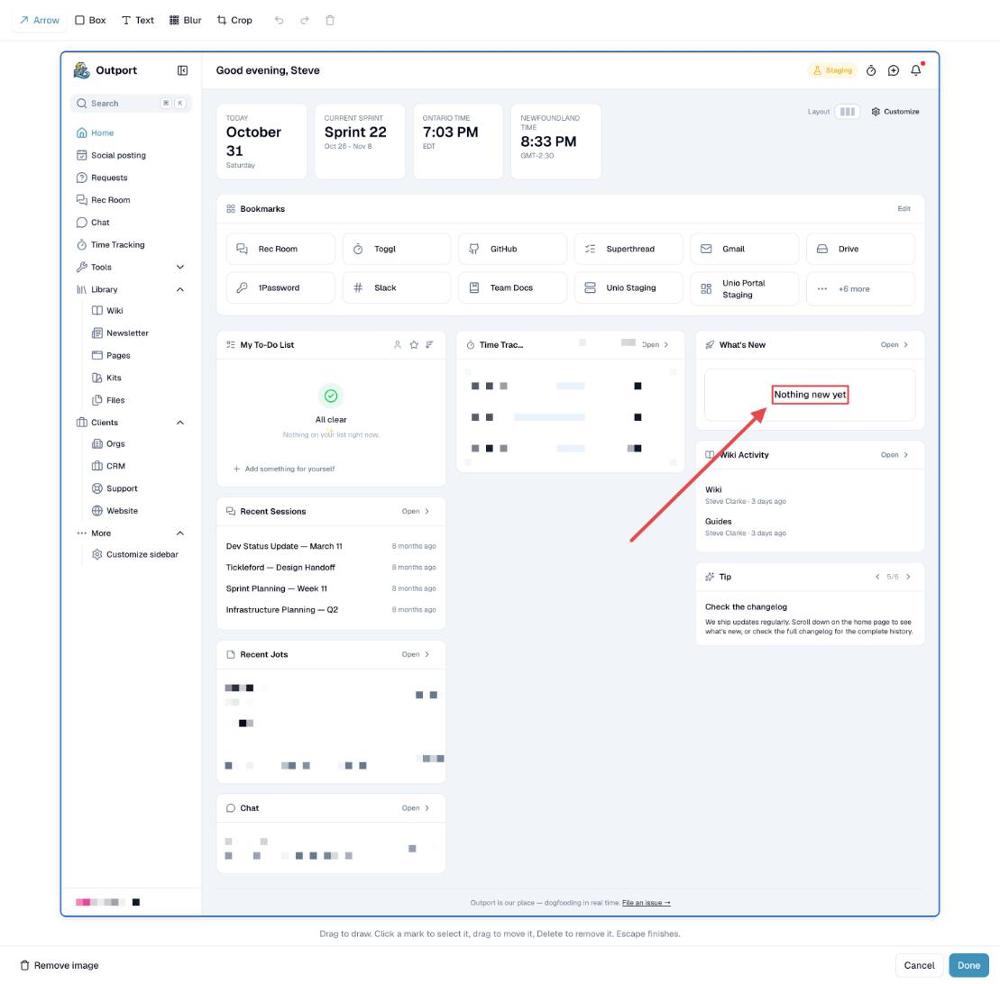

# Luh

**Let people point at the part of your site they want changed, and tell you why.**

Luh adds a feedback window to any website. A person writes a note, or points at an element first. They can attach a screenshot and draw on it, and private data is blurred before the picture leaves the browser. Your code receives one typed note and decides where it goes: an inbox, an issue tracker, or an agent that builds the change.



| Write a note about the part you picked | Draw on the screenshot; private areas are blurred for you |
|---|---|
|  |  |

_Luh_ is Newfoundland for "look!", said while pointing.

> [!NOTE]
> Luh is a work in progress. It is not on npm yet, and the API may change before 1.0.

## What it does

- **Point or write.** Open the window from your own button, or press `C` and click any element. The note carries what was picked and any selected words.
- **Screenshots and drawing.** Capture the page, add images, then draw arrows, boxes and text, blur or crop.
- **Private by default.** Typed fields are never in a screenshot. Mark other areas once with `data-luh="blur"` or `data-luh="hide"`, or turn Luh off on whole pages.
- **No framework, no service.** Plain ESM with TypeScript types. Luh stores nothing and sends nothing until the person presses Send; your code does the delivery.
- **Fits your site.** Light and dark themes, CSS tokens, stable shadow parts, your own icons and every word translatable.

## Install

Install from a GitHub release tag. Node 22.12 or newer is needed to build; the browser needs no Node.

```sh
npm install github:onethreefivechurch/luh#v0.5.0
```

## Quick start

Open the window from your own button, and send each note to your server:

```ts
import { createCommentMode } from '@onethreefivechurch/luh';

const notes = createCommentMode({
  async onSubmit(note) {
    const data = new FormData();
    data.append('body', note.body);
    data.append('context', JSON.stringify(note.context));
    if (note.screenshot) data.append('screenshot', note.screenshot);
    for (const image of note.images) data.append('images[]', image);

    const response = await fetch('/feedback', { method: 'POST', body: data });
    if (!response.ok) return { error: 'Your note did not send. Please try again.' };
  },
});

document.querySelector('#feedback')!
  .addEventListener('click', event => notes.open({ from: event }));
```

If `onSubmit` returns an error or throws, the note stays open with its words and images, so the person can try again. Your server owns the endpoint, sign-in, CSRF protection and spam control.

To keep an area out of screenshots, mark it in your markup:

```html
<section data-luh="blur">Salary: $85,000</section>
<aside data-luh="hide">…</aside>
```

## Learn more

| Guide | What it covers |
|---|---|
| [Using Luh](docs/usage.md) | The note window, picking, upload progress, plain HTML without a bundler, the `Note` fields and events |
| [Settings](docs/settings.md) | Every option, and translating the window |
| [Styling](docs/styling.md) | Themes, CSS tokens, shadow parts, Tailwind and Nuxt UI, your own trigger and icons |
| [Privacy and screenshots](docs/privacy.md) | What is kept out, page rules, and the limits of screenshots |
| [Development](docs/development.md) | The demo, the tests and building from source |

## Contributing

Issues and pull requests are welcome. Run the demo and the tests as described in [Development](docs/development.md). Changes are listed in [CHANGELOG.md](CHANGELOG.md). Versions follow SemVer; while Luh is `0.x`, a breaking change raises the minor version.

## License

MIT. Made by [135 Main Community Church](https://135main.org).
